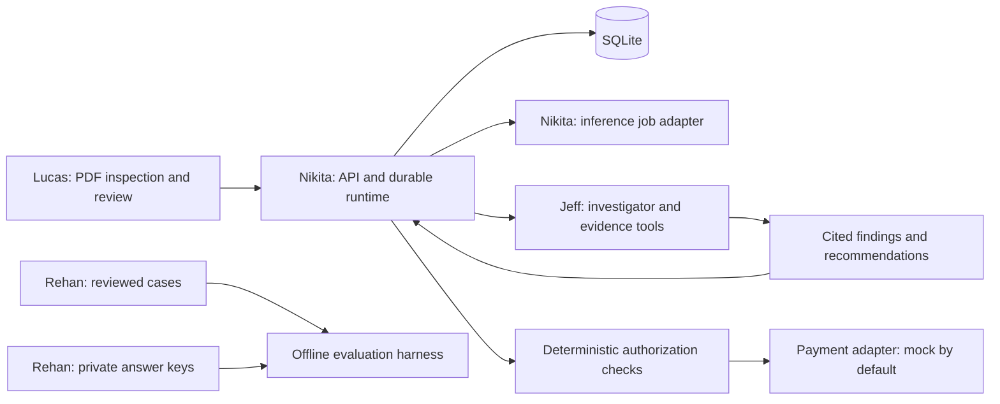

# Architecture and shared contracts

Product decisions live in [HACK.md](../HACK.md). Initial contracts are a reviewable
proposal for Nikita and Jeff; creating them does not imply their joint approval.

## Boundaries



Only the health API, contracts, investigator protocol, pure policy checks, and mock
payment journal/adapter exist. The diagram shows the intended integration. No graph,
provider client, PDF ingestion/rendering, order database, scheduler, or UI is wired.
LangGraph and the Anthropic SDK are installed but never invoked by the scaffold.

## Contract map

All models live in `backend/app/contracts/models.py` and forbid unknown fields.
Frozen nested models and tuples keep ordinary model access immutable; persisted
snapshots still need append-only storage rules. Never bypass validation with
`model_construct` or unvalidated `model_copy(update=...)` at application boundaries.

| Contract | Contents / invariant |
| --- | --- |
| `OrderSnapshot` | Frozen accepted brief, timestamp, exact inputs, structured data references, integer price and accepted policy. |
| `EvidenceReference` | Stable ID, version, SHA-256, opaque storage key, media type, evidence kind and optional provenance. |
| `DeliveryVersion` | Order/snapshot linkage, delivery version/time, output artifact references and internal structured data references. |
| `InvestigationInput` | Case/complaint, frozen snapshot, exact delivery, complete versioned evidence set, allocated proposal binding, regeneration count. |
| `InvestigationResult` | Same case/proposal binding, cited findings, unresolved issues, questions and recommendations. No payment permissions. |
| `SettlementIntent` | Capture/release proposal, amount, authorization ID and idempotency key. Not permission to execute. |

`Money.amount_minor` is a positive strict integer: JSON floats, numeric strings and
booleans are rejected. `currency` and `decimals` specify units. Token address/network
mapping awaits the spike; USD in tests is synthetic. Timestamps require timezones.
Pydantic's [strict validation](https://docs.pydantic.dev/latest/concepts/strict_mode/)
is used for monetary amounts and version numbers.

`ProposalBinding` contains `order_id`, `snapshot_id`, `delivery_version`,
`evidence_version`, and `proposal_version`. The runtime allocates monotonically
increasing versions; model validation alone cannot enforce monotonic history.
Any evidence addition/removal/change, including structured data, increments the
evidence-set version. Revised findings/recommendations get a new proposal version.
All approvals and verification must match the current complete binding. Evidence
content hashes must be checked by the future resolver against actual bytes.

## PDF inspection and reproducibility

PDF sources and deliveries are the customer-facing inspection surface. Artifact
references remain format-independent; no XLSX renderer or other output format is
implemented or selected. `structured_data` on snapshots and deliveries preserves
internal data references. Each structured sidecar must cite exact source IDs,
versions and hashes via `derived_from`; the investigation envelope includes those
sidecars. The real ingestion/provider flow must retain them for every PDF it produces
or parses. Optional schema fields allow components to be developed independently.

A `Citation` links an exact evidence ID/version/hash plus a human-readable locator.
For PDF evidence, `InvestigationResult.validate_for` also requires `highlights`:
one or more `PdfHighlight` rectangles. Each has a **one-based page number**, normalized
`x0,y0,x1,y1` in `[0,1]`, top-left origin on the displayed page, positive width/height.
Multiple rectangles represent multi-line or multi-page findings. Lucas resolves the
reference, opens the correct version/page, and highlights those regions. Never link
to a mutable “latest” artifact. The future resolver must check actual page counts,
and Lucas/Jeff must agree rotation/crop transforms before real PDF integration.

Internal structured data should retain stable record/field IDs mapped to PDF regions
so checks can be reproduced and their evidence can be inspected. The serialization
and row/field mapping are an open interface decision; no renderer or extractor exists.
Expected answers, mutation labels, and grading verdicts are not structured runtime data.

## Investigator interface

```python
from app.investigation.interface import Investigator

result = await investigator.investigate(request)
result.validate_for(request)
```

`Investigator` is an async protocol, not an implementation. Jeff has full ownership
of investigation strategy, prompts, tools, questions and recommendation quality.
There is no mandated LangGraph topology or model selection. Every finding needs at
least one citation to supplied evidence. Empty findings are valid when evidence is
insufficient; report unresolved issues/questions and recommend human review.
Recommendation actions currently are `free_regeneration`, `human_review`, `no_remedy`.

The runtime checks result citations/binding against the input, then compares the
binding to current persisted versions before using it. It persists the result and
applies deterministic policy. Recommendations do not establish verified defects,
customer consent, payment authority, or proof of settlement. Questions need a future
persist/resume protocol; errors/timeouts go to Nikita's retry/escalation machinery.

Only allowlisted order evidence may enter tools/prompts. A `storage_key` is opaque:
never open arbitrary paths/URLs supplied by a model. Implement a scoped resolver;
do not give the investigator repository browsing, shell access, payment credentials,
or access to the offline evaluation process. Put only approved evidence in its
workspace. Packaging builds only `backend/app`; `evals/expected` is outside that tree.
This is a packaging boundary, not a sandbox for an agent running at repository root.

## Deterministic policy and persistence boundary

`runtime/policy.py` separates `OrderState`, `DeliveryState`, `CaseState` and
`PaymentState`; there is no single catch-all status. `validate_capture` rejects
unverified/stale work, open disputes, human review, wrong amounts/authorizations,
submitted or uncertain payments, expired authorizations, and premature capture.
Capture is for exactly the accepted price. Acceptance can end the review wait;
without acceptance the current delivery must have had 60 seconds. An open dispute
blocks both paths. `decide_remedy` permits one regeneration and returns `human_review`
for ambiguity or any failed regeneration, even if the latest complaint is unsupported.

These are pure checks, not a durable state machine. Nikita must atomically read
authoritative state, check versions/authority, persist idempotency key + exact request,
and reserve the operation before execution. Re-read version/dispute state before
dispatch and serialize dispute/capture races. Persist regeneration usage once per
order before dispatch so retries cannot create a second free generation. Human
review must become a durable state and block automatic settlement.

## Payment boundary

`PaymentAdapter` defines async `authorize`, `execute` (capture/release), and
`reconcile`. A new idempotency key represents a new operation, never a retry of the
same operation. All repeats use the same exact payload/key. Release is also subject
to explicit deterministic authorization; its live policy is not implemented.

`get_payment_adapter()` only supports `mock`. Its local SQLite journal atomically
deduplicates calls, rejects changed payloads under a used key, and survives restart.
Every receipt is `mode=mock,status=mock`, with no transaction ID. No funds move and
the mock cannot satisfy the live capture guard's authorized-payment state.

For a future live adapter, persist pending/submitted/uncertain outcomes, reconcile
against the authoritative provider/chain, and confirm only under the spike's agreed
finality rule. A timeout or transaction hash is not confirmation. Never retry an
uncertain submission blindly. The current mock journal does not implement a live
outbox, reconciliation worker, or cross-process payment execution lease.

## Deployment boundary (future)

Railway backend root should be `backend/`, with a persistent SQLite volume. Exclude
`evals/expected`, corpus mutation metadata, private artifacts and credentials from
runtime/public images. Configure frontend/backend origins only when Lucas and Nikita
agree on API/auth; do not expose secrets in `NEXT_PUBLIC_*`. No deployment is created.
